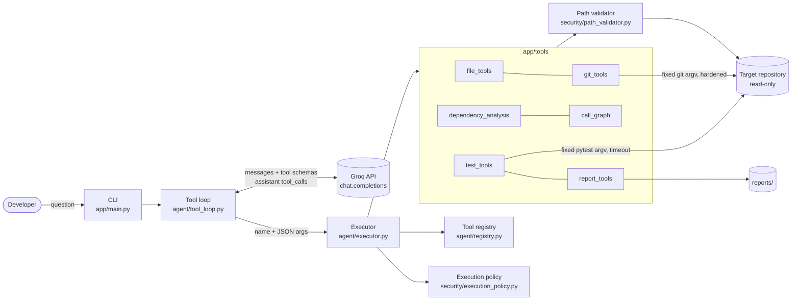
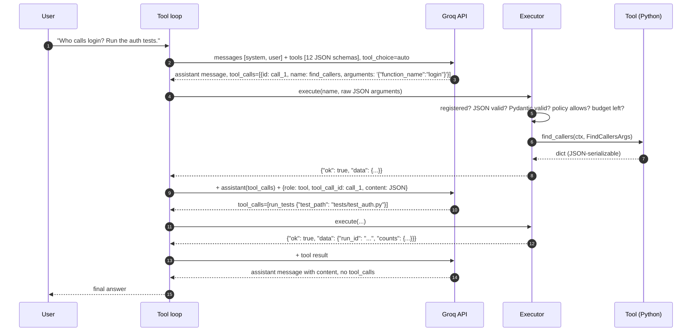

# DevPilot

**An AI developer assistant that investigates a local Python codebase using direct Groq tool calling.**

Ask a question in plain English. The model decides which of 12 tools to call: read and search files, inspect Git history, analyze imports and call graphs with Python's AST, run pytest, and write a Markdown report. It chooses the order based on earlier results. DevPilot validates every request and runs it locally inside strict security boundaries.

No LangChain, LangGraph, MCP, CrewAI or other agent framework. The whole orchestration layer (loop, executor and registry) is about 600 lines of plain Python in [`app/agent/`](app/agent/), so every step can be explained.

---

## Contents

1. [Tools](#tools)
2. [Architecture](#architecture)
3. [How tool calling works here](#how-tool-calling-works-here)
4. [Installation and configuration](#installation-and-configuration)
5. [CLI usage](#cli-usage)
6. [Example requests](#example-requests)
7. [Testing](#testing)
8. [Security boundaries](#security-boundaries)
9. [Known limitations](#known-limitations)
10. [Future improvements](#future-improvements)
11. [Project structure](#project-structure)

---

## Tools

| # | Tool | Category | Complexity | What it does |
|---|---|---|---|---|
| 1 | `list_files` | Basic file | Basic | Recursive listing. Skips `.git`, virtualenvs, build output and secret files. Capped at 300 entries. |
| 2 | `search_code` | Basic file | Basic | Literal text search (not regex, so there is no ReDoS risk). Returns path, line and snippet. Size and match limits apply. |
| 3 | `read_file` | Basic file | Basic | Returns the file with line numbers. Blocks secrets, `.git/`, path traversal and files over 200 KB. |
| 4 | `get_git_status` | Git | Basic–Medium | Shows branch, staged, modified and untracked files. Secret paths are withheld. |
| 5 | `get_commit_history` | Git | Medium | Lists hash, author, ISO date and subject. The limit is 1–50. Author e-mails are not requested. |
| 6 | `get_diff` | Git | Medium | Shows changed files, line counts and a unified diff of the working tree or staged changes. The diff is size-capped and secret files are withheld. |
| 7 | `analyze_dependencies` | Static analysis | Medium–Advanced | Uses the AST to classify imports as internal, stdlib, external or unresolved. Builds the dependency edges and runs Tarjan's algorithm to find import cycles. |
| 8 | `find_callers` | Static analysis | Advanced | Uses the AST to resolve call sites. Results are split into **confirmed** callers, **uncertain** matches and references without a call. |
| 9 | `trace_function_flow` | Static analysis | Advanced | Walks a bounded call graph with depth and node limits. Detects direct and mutual recursion and reports calls it could not resolve. |
| 10 | `run_tests` | Test | Medium | Runs pytest with a fixed argv, no shell, a timeout that kills the process group, and a scrubbed environment. |
| 11 | `analyze_test_results` | Test | Medium | Parses JUnit XML from a recorded run, or raw pytest output. Observed failures are kept separate from heuristic explanations. |
| 12 | `create_report` | Reporting | Basic–Medium | Writes a Markdown report to the reports directory only. Test results are copied from recorded runs, and code references are verified. |

---

## Architecture



Responsibilities are deliberately separated:

- **`tool_loop.py`** talks to Groq and manages the conversation. It never executes tools itself.
- **`executor.py`** is the trust boundary. It looks up the tool, parses the JSON, validates with Pydantic, checks policy, then runs the handler with a timeout.
- **`registry.py`** stores tool metadata: name, description, input model, handler, permission and category.
- **`app/tools/*`** are plain Python functions with the signature `(ToolContext, validated_args) -> dict`. They know nothing about the LLM.
- **`app/security/*`** handles path containment, secret-file rules, the Git allowlist and execution budgets.

---

## How tool calling works here



### 1. Tool schemas

Each tool's arguments are a Pydantic model. That model is the single source of truth for two things:

- **The JSON Schema sent to Groq.** `Tool.json_schema()` turns it into `{"type": "function", "function": {name, description, parameters}}`. `$defs` are inlined and auto-titles are removed.
- **Validation of what comes back.** `model_validate` checks the model's arguments.

All models use `extra="forbid"`, which becomes `additionalProperties: false`. Bounds are encoded in the schema, for example `limit: 1..50`, `maximum_depth: 1..6`, and function-name patterns.

### 2. How the model selects tools

DevPilot sends all enabled schemas on every request with `tool_choice="auto"`. The model reads each tool's description and the conversation so far, including earlier tool results, and returns either:

- an assistant message with `tool_calls`, each with an `id`, a `function.name` and `function.arguments` as a JSON string, or
- a normal text answer, which ends the loop.

The order is not hardcoded. A test in [`tests/test_tool_loop.py`](tests/test_tool_loop.py) shows the next call depending on a previous result. The fake model reads `find_callers` output and then opens the caller's file.

### 3. How Python executes tools

For every call the model returns, the executor runs these steps in order. Any failure becomes a structured error *returned to the model*, never an exception that kills the loop.

1. Look up the name in the registry. Unknown names give `unknown_tool` plus the list of valid names.
2. Run `json.loads` on the arguments, which must be a JSON object. Otherwise it returns `invalid_json`.
3. Validate with Pydantic. Failures give `invalid_arguments` with field-level messages.
4. Check policy: the permission must be enabled, and the total and per-tool call budgets must not be exhausted. Otherwise it returns `permission_denied`. Calls that fail validation do not consume budget.
5. Run the handler in a worker thread with a timeout. Path and security failures give `security_violation`, known failures give `tool_error`, crashes give `internal_error`, and slow tools give `timeout`.

### 4. How results return to the model

The loop first appends the assistant message containing the `tool_calls`. Then it appends one message per call:

```json
{"role": "tool", "tool_call_id": "call_1", "name": "find_callers", "content": "{\"ok\": true, \"data\": {...}}"}
```

Results are JSON strings capped at 24,000 characters. Oversized results are replaced with a truncated preview and a note asking the model to narrow its request. The full conversation is sent back to Groq and the cycle repeats.

### 5. Stopping conditions

| Condition | Result status |
|---|---|
| Model returns text without tool calls | `completed` |
| `DEVPILOT_MAX_TOOL_ROUNDS` reached | `max_rounds`. One final request with `tool_choice="none"` asks for a summary of findings so far. |
| Groq timeout | `api_timeout` |
| Groq 400 `tool_use_failed`, meaning the model emitted an unparsable tool call | Retried up to 2 times with a corrective message, then `api_error` |
| Other API or connection errors | `api_error` |
| Empty model response | Retried once, then `empty_response` |
| Tool call without `id` or `function` | `malformed_response` |

### Sequential vs parallel tool calls

`parallel_tool_calls` defaults to **false**, controlled by `DEVPILOT_PARALLEL_TOOL_CALLS`. If a model still returns several tool calls in one response, DevPilot executes them **one at a time in the listed order**. Every `tool_call_id` gets exactly one `role: tool` reply, which the API requires.

### Model choice

The default is **`openai/gpt-oss-120b`**. On 2026-10-16 it was listed as a *production* model in Groq's catalog with tool-use support and a 131,072-token context window. It was chosen as the strongest production model for multi-step tool use.

Groq's documentation says the GPT-OSS models do **not** support parallel tool calls. That fits DevPilot's sequential default.

The alternative is `llama-3.3-70b-versatile`, a production model that does support parallel tool calls. Switch with `DEVPILOT_MODEL` or `--model`. The model is never hardcoded outside the config default.

Sources: [Groq models](https://console.groq.com/docs/models), [Groq tool use](https://console.groq.com/docs/tool-use), [API reference](https://console.groq.com/docs/api-reference). The request uses `max_completion_tokens`, because the API reference deprecates `max_tokens`.

---

## Installation and configuration

Requirements: Python 3.11+, Git, and a Groq API key from <https://console.groq.com/keys>.

```bash
cd devpilot
python3 -m venv .venv
source .venv/bin/activate
pip install -r requirements.txt
cp .env.example .env        # then set GROQ_API_KEY
```

| Variable | Default | Purpose |
|---|---|---|
| `GROQ_API_KEY` | (required) | Groq API key. It is never printed, and `Settings.__repr__` hides it. |
| `DEVPILOT_REPO_PATH` | current directory | Repository to analyze. `--repo` overrides it. |
| `DEVPILOT_MODEL` | `openai/gpt-oss-120b` | Groq model ID. `--model` overrides it. |
| `DEVPILOT_MAX_TOOL_ROUNDS` | `10` | Model round-trips per question. |
| `DEVPILOT_MAX_TOOL_CALLS` | `30` | Total tool executions per question. |
| `DEVPILOT_TOOL_TIMEOUT` | `60` | Seconds per in-process tool. |
| `DEVPILOT_TEST_TIMEOUT` | `120` | Seconds per pytest run. The process group is killed after this. |
| `DEVPILOT_API_TIMEOUT` | `60` | Seconds per Groq request. The SDK retries twice. |
| `DEVPILOT_PARALLEL_TOOL_CALLS` | `false` | Value of `parallel_tool_calls` in requests. |
| `DEVPILOT_ALLOW_TEST_EXECUTION` | `true` | Set to `false` to remove `run_tests` from the tools offered to the model. |
| `DEVPILOT_ALLOW_REPORTS` | `true` | Set to `false` to remove `create_report`. |
| `DEVPILOT_PYTHON` | DevPilot's interpreter | Interpreter used for `python -m pytest`. Point it at the target project's venv. |
| `DEVPILOT_REPORTS_DIR` | `./reports` | The only directory DevPilot writes to. |
| `DEVPILOT_EXTRA_EXCLUDED_DIRS` | (empty) | Comma-separated directory names to skip. |
| `DEVPILOT_EXTRA_SENSITIVE_PATTERNS` | (empty) | Comma-separated filename globs to block. |

---

## CLI usage

```bash
python -m app.main                                   # interactive; repo = DEVPILOT_REPO_PATH or cwd
python -m app.main --repo examples/sample_app        # analyze the bundled demo project
python -m app.main --repo ../my-project -q "Which modules import requests?"   # one-shot
python -m app.main --model llama-3.3-70b-versatile   # different Groq model
```

Inside the interactive prompt, `/tools` lists tools and whether they are enabled, and `/exit` quits. Ctrl+C during a question cancels that question. Ctrl+C or Ctrl+D at the prompt exits.

Each question is answered independently, with no chat memory between questions.

### Example session

The tool-trace lines below are real CLI output from a scripted run against `examples/sample_app`. The final answer is **illustrative**: real model wording varies from run to run.

```text
$ python -m app.main --repo examples/sample_app
DevPilot - AI developer assistant (read-only)
Repository : /…/devpilot/examples/sample_app
Model      : openai/gpt-oss-120b
Type a question, '/tools' to list tools, or '/exit' to quit. Ctrl+C cancels.

devpilot> Find the authentication code, explain the login flow, list who calls login,
          check recent commits and run the tests.
  -> calling search_code
     search_code({"query": "login"}) [ok, 0.008s]
  -> calling read_file
     read_file({"file_path": "auth/service.py"}) [ok, 0.001s]
  -> calling find_callers
     find_callers({"function_name": "login"}) [ok, 0.005s]
  -> calling get_commit_history
     get_commit_history({"limit": 5}) [ok, 0.036s]
  -> calling run_tests
     run_tests({"test_path": "tests"}) [ok, 0.241s]
  -> calling analyze_test_results
     analyze_test_results({"run_id": "6004ab6e3b84"}) [ok, 0.0s]

Login flow (auth/service.py):
- login() (line 19) builds AuthService and calls authenticate() (line 9)
- authenticate() checks the password via verify_password (auth/passwords.py:8)
  and issues a token through _issue_token -> tokens.create_token
Confirmed callers of login: web/views.py:5 (login_view), tests/test_auth.py:9, :13
Uncertain: web/views.py:15 uses getattr(module, "login") (dynamic)
Tests: 5 run, 4 passed, 1 failed - tests/test_known_bug.py::test_parse_token_with_colon_in_username
(AssertionError). Hypothesis: parse_token splits on the first ':' only.

(6 tool calls, 7 model rounds)
```

---

## Example requests

These three requests exercise different tool combinations against `examples/sample_app`:

1. **Code understanding.** "Explain the login flow and list every function that calls `login`."
   Likely tools: `search_code`, `read_file`, `find_callers`, `trace_function_flow`.
2. **Change review.** "What has changed since the last commit, and do the tests still pass?"
   Likely tools: `get_git_status`, `get_diff`, `get_commit_history`, `run_tests`, `analyze_test_results`.
3. **Architecture audit with a report.** "Check the `utils` package for circular imports and recursion and write a report."
   Likely tools: `analyze_dependencies`, `trace_function_flow` on `is_even` and `factorial`, `create_report`.

The model picks the actual tools, so the sequence can differ from these lists.

`examples/sample_app` deliberately contains an auth flow, a module-level import cycle, a cycle that exists only through a deferred import, direct and mutual recursion, and one failing test. Every tool therefore has something to find.

---

## Testing

```bash
pytest                       # 182 unit tests; no API key, no network
ruff check app tests         # lint
ruff format --check app tests
```

The unit tests use a **scripted fake Groq client**: no network calls and no API key. Each test builds a throw-away Git repository from `examples/sample_app`, with planted `.env` and `id_rsa` files that must never leak. They cover:

- **Loop:** sequential calls, adaptive tool choice, multiple calls per response, unknown tools, invalid JSON and invalid arguments, tool crashes, timeouts, budgets, max rounds, API errors and `tool_use_failed` retries, empty and malformed responses.
- **Security:** path traversal, symlink escape, secret files, `.git/` access, the Git subcommand allowlist, and a hostile `core.fsmonitor` repository config that must not execute.
- **Tools:** AST import cycles and deferred-import cycles, call resolution, recursion, depth and node limits, pytest timeout kill, environment scrubbing, JUnit parsing, and report path containment.

**Live Groq integration test.** It is skipped unless enabled:

```bash
DEVPILOT_RUN_INTEGRATION=1 GROQ_API_KEY=gsk_... pytest tests/integration -m integration -v -s
```

---

## Security boundaries

DevPilot treats **all model output as untrusted input**, and also treats the target repository's content and config as untrusted.

| Boundary | Enforcement |
|---|---|
| Only registered tools run | Registry lookup. The model cannot name a function that is not registered. Python code from the model is never `eval`'d or executed. |
| Arguments validated | Pydantic models with `extra="forbid"`, bounds and patterns, applied before any execution. |
| Repository sandbox | `resolve_in_repo` resolves symlinks, then requires the path to stay under the repository root. Null bytes, `..` escapes and absolute paths outside the root are rejected. |
| Secrets | `.env*` (except `.env.example`, `.env.sample` and `.env.template`), keys, certificates, `credentials*`, `secrets.*`, `.netrc`, `.pypirc` and similar files are blocked from reads, listing, search, diffs and status. `.git/`, `.venv/` and similar directories are never readable. |
| Symlinks | A symlink is followed only if its *target* passes the same rules. A link named `notes.txt` that points to `.env` is neither listed nor searched nor read. |
| Read-only Git | Subcommand allowlist: `status`, `log`, `diff`, `rev-parse`. Options that write output or run programs are rejected. Model-supplied paths always follow `--`, and `GIT_LITERAL_PATHSPECS=1` makes pathspec magic such as `:(glob)**` a plain file name. |
| Hostile repository config | Every Git call adds `-c core.fsmonitor=false -c core.hooksPath=/dev/null -c core.pager=cat -c diff.external= -c protocol.allow=never --no-pager`, plus `--no-ext-diff --no-textconv` for diffs. It also sets `GIT_OPTIONAL_LOCKS=0`, so `git status` does not rewrite the index. A test confirms that a repository's `core.fsmonitor` command does not run. |
| No shell | Every subprocess uses an argv list with `shell=False`. |
| Restricted tests | Fixed argv: `python -m pytest <validated target> -q -rfE --tb=short -p no:cacheprovider --junitxml=<temp>`. Targets starting with `-` are rejected, and node IDs are pattern-checked. The environment drops `GROQ_*`, `DEVPILOT_*`, anything that looks like `*KEY*`, `*TOKEN*`, `*SECRET*` or `*PASSWORD*`, and `PYTEST_ADDOPTS`. `PYTHONDONTWRITEBYTECODE=1` and the disabled cache keep the repository unmodified. The timeout kills the whole process group. |
| Writes | Only `create_report` writes, and only to the configured reports directory. The filename is generated from a timestamp and a slug. The file is opened with exclusive create, so it never overwrites. |
| Budgets | Rounds, total calls, `run_tests` limited to 3 per question, `create_report` limited to 3 per question, per-tool timeouts and output-size caps. |

> **Important:** `run_tests` executes the target repository's test code, and test code is arbitrary Python by nature. Only point DevPilot at repositories you trust, or set `DEVPILOT_ALLOW_TEST_EXECUTION=false`.

---

## Known limitations

- **Static analysis is approximate.** `find_callers` and `trace_function_flow` resolve same-module calls, imports, `module.func()`, `self.method()` and `Class.method()`. They do not infer variable types, inheritance, decorators, `functools.partial`, dependency injection or monkey-patching. These cases show up as *uncertain* or *unresolved* rather than being silently dropped.
- **Python only** for the dependency and call-graph tools. File, Git and search tools work on any text.
- **Thread timeouts cannot kill Python code.** A timed-out in-process tool returns an error immediately but may finish in the background. The subprocess tools, git and pytest, are hard-killed.
- **Prompt injection.** File contents reach the model, and a malicious file could try to steer it. The impact is limited because every tool is read-only, except report writing to a fixed directory, and every argument is validated. The model's *answer* could still be misled.
- **No conversation memory** between CLI questions.
- **No coverage measurement.** `analyze_test_results` says so explicitly.
- **Live Groq behaviour was not exercised during development.** No API key was available. The request and response handling follows the official Groq SDK 1.7.0 types and docs and is covered by mocked tests. Run the integration test above to confirm against the live API.
- **Process-group kill on timeout is POSIX-only.** It works on macOS and Linux. On Windows only the direct child is killed.

---

## Future improvements

- Cache the parsed AST and call index per session, keyed by file mtimes.
- Light type inference, for example `x = ClassName(...)` followed by `x.method()`, to turn more uncertain callers into confirmed ones.
- Multi-turn chat memory with summarization of old tool results.
- Optional coverage collection with `pytest-cov`, reported only when actually measured.
- Run `run_tests` inside a container or sandbox for untrusted repositories.
- Streaming responses and token-usage reporting.

---

## Project structure

```
devpilot/
  app/
    main.py                     CLI
    config.py                   Settings, limits, defaults (all tunables)
    agent/
      tool_loop.py              Groq client wrapper + tool-calling loop
      executor.py               Trust boundary: lookup -> parse -> validate -> authorize -> run
      registry.py               Tool dataclass, ToolRegistry, schema generation
      schemas.py                Loop result types (ToolExecutionResult, AgentResult, AgentEvent)
    tools/
      registration.py           build_registry(): explicit registration of all 12 tools
      common.py                 ToolContext, ToolError, shared helpers
      file_tools.py             list_files, search_code, read_file
      git_tools.py              get_git_status, get_commit_history, get_diff
      python_ast.py             Shared AST loading + import resolution
      dependency_analysis.py    analyze_dependencies (+ Tarjan SCC)
      call_graph.py             find_callers, trace_function_flow
      test_tools.py             run_tests, analyze_test_results
      report_tools.py           create_report
    security/
      path_validator.py         Repo containment, secret rules, safe directory walking
      execution_policy.py       Permissions, budgets, timeouts, Git allowlist + hardening flags
  examples/sample_app/          Demo/fixture project (auth flow, cycles, recursion, a failing test)
  tests/                        Unit tests (+ integration/ for the live Groq test)
  reports/                      Generated reports (git-ignored except .gitkeep)
```

**Differences from the suggested layout, and why:**

- **`tools/registration.py` instead of registering in `tools/__init__.py`.** The registry imports `app.tools.common`, so registering in the package `__init__` created a circular import. Registration got its own module, and `__init__` stays empty.
- **`agent/executor.py` was added.** It keeps tool execution and validation separate from Groq API calls in `tool_loop.py`.
- **`agent/schemas.py` holds loop result types.** Each tool's input schema is a Pydantic model next to its implementation, so the schema and the code that relies on it change together.
- **`tools/python_ast.py` and `tools/common.py` were added.** They are shared by several tools, which avoids duplicating the AST loading and context code.
- **Added files:** `examples/sample_app/`, a realistic demo and test fixture; `tests/conftest.py`; `tests/test_cli.py`; and `tests/integration/`.
